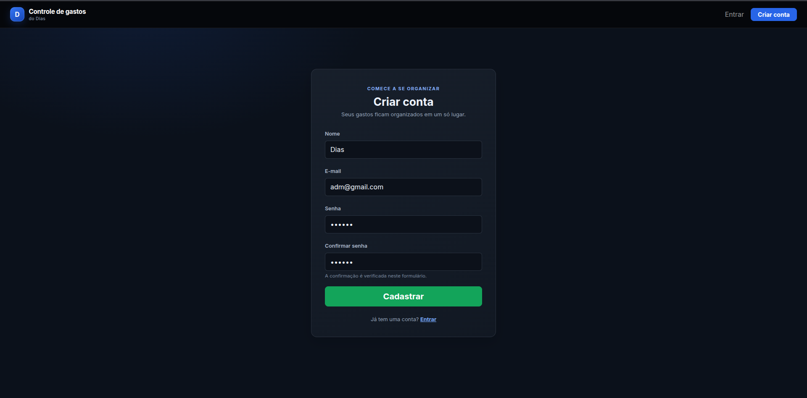
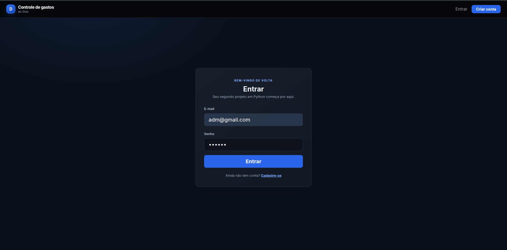
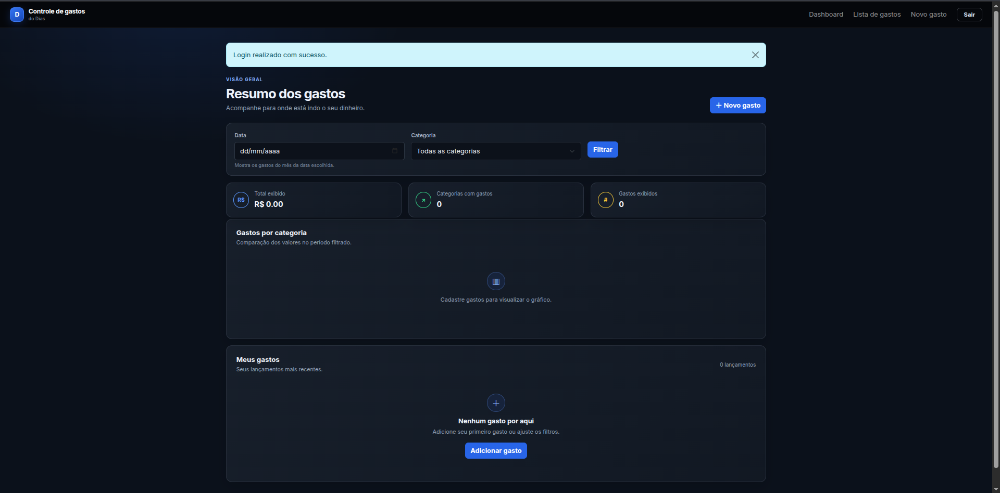
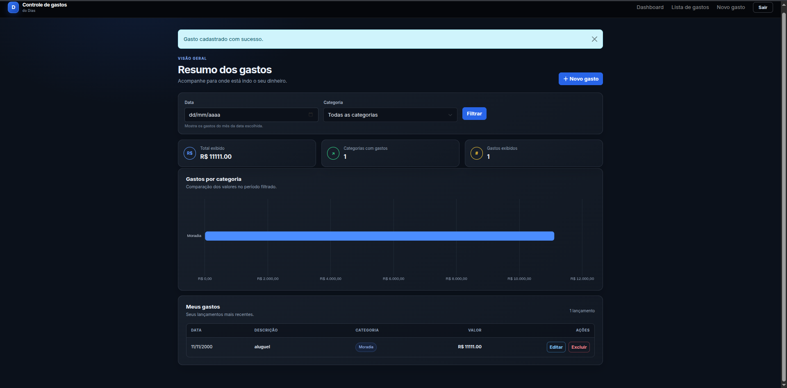
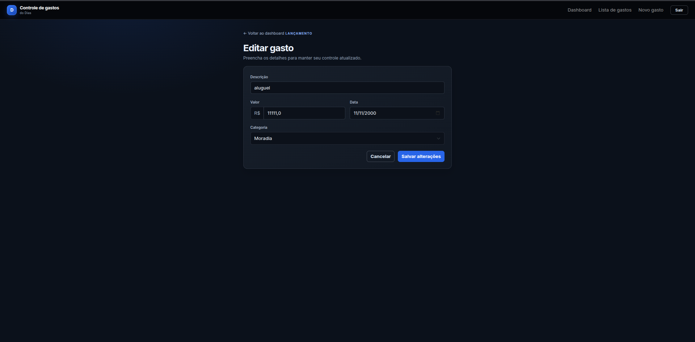

# Gerenciador de Gastos Pessoais

Aplicação web para registrar e acompanhar gastos pessoais. Cada usuário cria uma conta e acessa seus próprios lançamentos, com filtros por mês e categoria, resumo dos valores e gráfico por categoria.

## Funcionalidades

- Cadastro de usuário e login/logout.
- Senhas armazenadas com hash.
- Cadastro, consulta, edição e exclusão de gastos.
- Gastos associados ao usuário que os cadastrou.
- Filtros por mês e categoria.
- Soma dos gastos exibidos no período filtrado.
- Gráfico de barras com os totais por categoria.
- Interface responsiva para celular e computador.

## Capturas de tela

### Cadastro



### Login



### Dashboard sem gastos



### Dashboard com gasto



### Edição de gasto



## Tecnologias

- Python, Flask e Flask-Login
- SQLite
- HTML, CSS, Bootstrap e Jinja2
- JavaScript e Chart.js

## Como executar localmente

Tenha Python 3 instalado. No terminal, dentro da pasta do projeto, crie e ative o ambiente virtual:

```bash
python3 -m venv .venv
source .venv/bin/activate
```

Instale as dependências:

```bash
python -m pip install -r requirements.txt
```

Inicie a aplicação:

```bash
python app.py
```

Abra [http://127.0.0.1:5012](http://127.0.0.1:5012) no navegador. Crie uma conta para começar a usar o sistema.

O banco de dados SQLite (`gastos.db`) e as tabelas são criados pela aplicação ao iniciar.

## Estrutura do projeto

```text
gerenciador-de-gastos/
├── app.py
├── models.py
├── requirements.txt
├── README.md
├── docs/
│   └── images/
│       ├── cadastro.png
│       ├── login.png
│       ├── dashboard-vazio.png
│       ├── dashboard-com-gastos.png
│       └── editar-gasto.png
├── static/
│   ├── css/style.css
│   └── js/
│       ├── cadastro.js
│       ├── dashboard-filters.js
│       └── dashboard.js
└── templates/
    ├── base.html
    ├── cadastro.html
    ├── dashboard.html
    ├── form_gasto.html
    ├── gastos.html
    └── login.html
```

## Uso de inteligência artificial

Usei uma ferramenta de inteligência artificial como apoio na criação e estilização do front-end com Bootstrap e JavaScript, incluindo o gráfico. As funcionalidades em Python foram desenvolvidas completamentes por mim.
